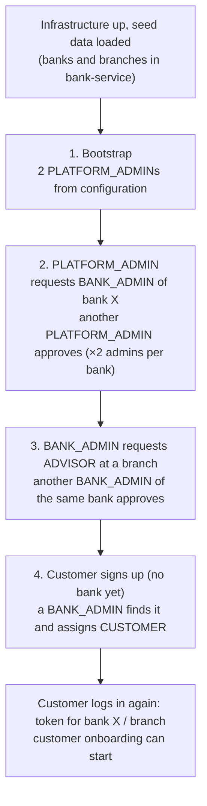
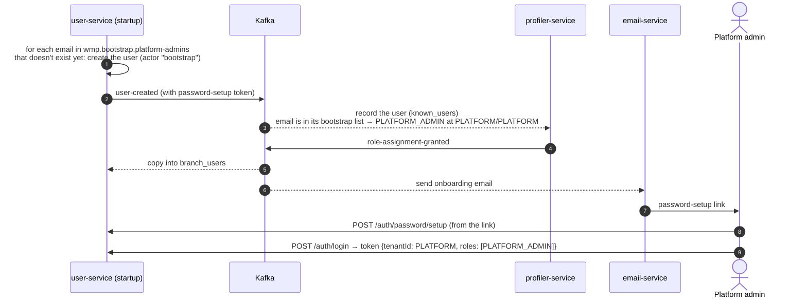
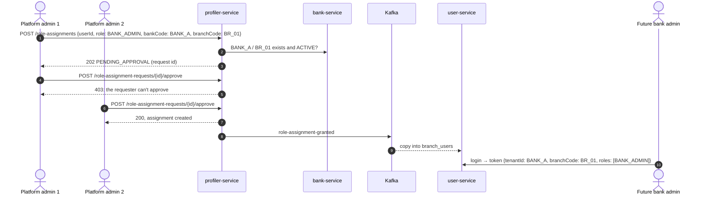
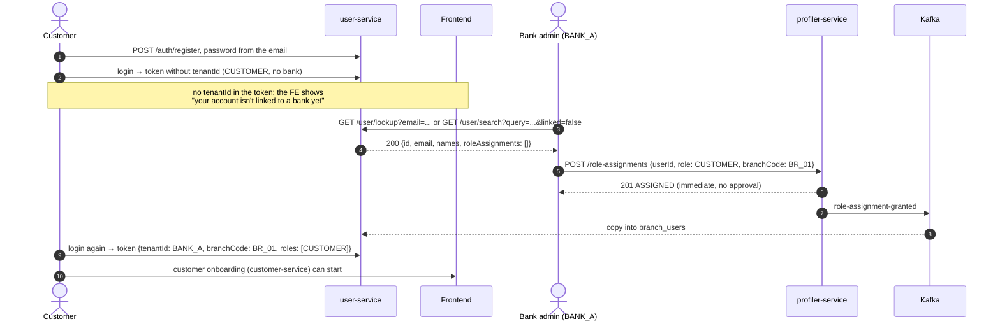
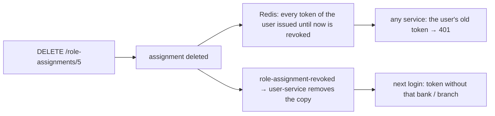

# First platform run

How to go from an **empty installation** to a working platform: the first platform admins, a bank with its admins,
its advisors, and the first self-registered customer linked to a branch. Every step shows who does it, what happens
behind the scenes and the exact calls (the FE makes the same calls).

The rules behind each step (who may assign what, four-eyes approval, revocation) are in
[roles and permissions](../security/roles-and-permissions.md); how tokens are issued and validated is in
[JWT authentication](../security/jwt-authentication.md).

## Contents
1. [The big picture](#1-the-big-picture)
2. [Prerequisites](#2-prerequisites)
3. [Step 1: bootstrap the platform admins](#3-step-1-bootstrap-the-platform-admins)
4. [Step 2: give a bank its first bank admins](#4-step-2-give-a-bank-its-first-bank-admins)
5. [Step 3: create advisors](#5-step-3-create-advisors)
6. [Step 4: a customer signs up and gets linked](#6-step-4-a-customer-signs-up-and-gets-linked)
7. [Step 5: revoking access](#7-step-5-revoking-access)
8. [Troubleshooting](#8-troubleshooting)
9. [Helper commands](#9-helper-commands)

---

## 1. The big picture



Two things to keep in mind:
- **Nobody can give themselves a role, and staff roles need a second person.** That's why the platform starts with
  two platform admins and each bank needs two bank admins before it can get advisors.
- **A new role reaches the user at its next login** (or branch switch). Tokens already issued don't change.

Who owns what:

| Concern | Service |
|---|---|
| Users, passwords, login, tokens | user-service (`:8083/user-service`) |
| Role assignments, four-eyes requests, permissions | profiler-service (`:8082/profiler-service`) |
| Banks and branches | bank-service (`:8089/bank-service`) |
| Onboarding emails (password-setup links) | email-service → MailHog (`:8025`) locally |
| Revoked tokens, ended sessions | Redis (`:6379`) |

## 2. Prerequisites

1. **Infrastructure**: `docker compose -f docker-compose.yml up -d` (Kafka, one Postgres per service, Redis, MailHog,
   WireMock...).
2. **Seed data**, once per fresh database (the tables are created by Hibernate when each service starts for the first time, so start the
   service once before seeding; see CLAUDE.md, "Configuration"):

   | Database | Script |
   |---|---|
   | bankdb | `business-modules/bank-service/bank-core/src/main/resources/sql/insertBankBranches.sql` (includes the local test branches `BANK_A`/`BR_01` and `BANK_B`/`BR_09`) |
   | profilerdb | `business-modules/profiler-service/profiler-core/src/main/resources/sql/populate_config_tables.sql`: the permission catalogue (sections, features, permission codes) and what each role may do. It takes effect at once, no restart needed. An **existing** profilerdb with the old catalogue first needs `sql/migrations/2026-10-31-align-catalogue-with-fe.sql` (same folder; its header gives the order) |
   | customerdb | `business-modules/customer-service/customer-core/src/main/resources/sql/financialAndGoalTypeInserts.sql`, `mifidConfigurationInserts.sql` (same folder) |
   | documentdb | `business-modules/document-service/document-core/src/main/resources/sql/initDocTypes.sql` |

   ```bash
   docker compose exec -T postgres-bank psql -U test -d bankdb < business-modules/bank-service/bank-core/src/main/resources/sql/insertBankBranches.sql
   ```
   PowerShell: `Get-Content <script> | docker compose exec -T postgres-bank psql -U test -d bankdb`.
3. **Services**: bank, user, profiler and email at least (customer and document for onboarding).
4. **Platform admin emails**: set `WMP_BOOTSTRAP_PLATFORM_ADMINS` (comma-separated) to the **same value** for
   user-service and profiler-service. Locally both default to
   `platform-admin-1@wmp.local,platform-admin-2@wmp.local`.

## 3. Step 1: bootstrap the platform admins

Nothing to call: it happens when user-service starts.



1. Start user-service and profiler-service. user-service logs
   `Bootstrap: created platform admin user [platform-admin-1@wmp.local]`, profiler logs
   `Bootstrap: PLATFORM_ADMIN assigned to [...]`.
2. Each platform admin opens its onboarding email (locally: MailHog, http://localhost:8025) and sets a password
   through the link. The same through the API:
   ```bash
   curl -X POST http://localhost:8083/user-service/auth/password/setup \
     -H "Authorization: Bearer <token from the link>" -H "Content-Type: application/json" \
     -d '{"password":"<password>"}'
   # 202
   ```
3. Log in: the token carries `tenantId: PLATFORM` and `roles: [PLATFORM_ADMIN]`.

The bootstrap is **idempotent**: on later starts existing users are left alone. A platform admin can't see any bank
data (`PLATFORM` is not a bank): its job is creating bank admins.

## 4. Step 2: give a bank its first bank admins

The future bank admins sign up like anyone else (`POST /auth/register`, password from the email). Then:



```bash
P=http://localhost:8082/profiler-service
# platform admin 1 requests (login within the last 10 minutes)
curl -X POST $P/role-assignments -H "Authorization: Bearer $PA1_TOKEN" -H "Content-Type: application/json" \
  -d '{"userId":"<bank admin user id>","role":"BANK_ADMIN","bankCode":"BANK_A","branchCode":"BR_01"}'
# 202 {"outcome":"PENDING_APPROVAL","request":{"id":1,"status":"PENDING",...}}

# platform admin 2 sees and approves it
curl "$P/role-assignment-requests?status=PENDING" -H "Authorization: Bearer $PA2_TOKEN"
curl -X POST $P/role-assignment-requests/1/approve -H "Authorization: Bearer $PA2_TOKEN"
# 200 {"id":..,"role":"BANK_ADMIN","grantedBy":"platform-admin-1@...","approvedBy":"platform-admin-2@..."}
```

The user id comes from `GET /user/lookup?email=` (see step 4). The bank and branch come from bank-service: a platform
admin lists every bank with `GET /bank/banks` and its branches with
`GET /bank/branches?bankCode=BANK_A&status=ACTIVE`, which is what the FE's dropdowns show. **Repeat for a second bank
admin** of the same bank (the platform admins swap roles): advisors need a second bank admin to approve them.

## 5. Step 3: create advisors

Same flow, one level down: a BANK_ADMIN requests, **another** BANK_ADMIN of the same bank approves.

```bash
curl -X POST $P/role-assignments -H "Authorization: Bearer $BANK_ADMIN_1_TOKEN" -H "Content-Type: application/json" \
  -d '{"userId":"<advisor user id>","role":"ADVISOR","branchCode":"BR_01"}'
# 202 PENDING_APPROVAL; no bankCode: the bank is the admin's own

curl -X POST $P/role-assignment-requests/<id>/approve -H "Authorization: Bearer $BANK_ADMIN_2_TOKEN"
# 200; a bank admin of another bank gets 403, the requester itself gets 403
```

Both calls need the **calling bank admin** to have logged in within the last 10 minutes, otherwise they answer
`401 REAUTHENTICATION_REQUIRED`: sign in again and retry. The advisor gets the ADVISOR role at its next login.

## 6. Step 4: a customer signs up and gets linked

A self-registered customer belongs to no bank yet. Only **bank admins** (and platform admins) can find such users, so
linking a new customer is a bank admin task. An advisor can't see users who aren't in its branch.



```bash
U=http://localhost:8083/user-service
# find the customer: exact email, or a search among users not linked to any bank yet
curl "$U/user/lookup?email=ada@bank.test" -H "Authorization: Bearer $BANK_ADMIN_TOKEN"
# 200 {"id":"<customer user id>","email":"ada@bank.test",...,"roleAssignments":[]}
curl "$U/user/search?query=bank.test&linked=false&page=0&size=20" -H "Authorization: Bearer $BANK_ADMIN_TOKEN"
# 200 {"content":[...],"page":0,"size":20,"totalElements":..,"totalPages":..}

# link it to a branch of the bank
curl -X POST $P/role-assignments -H "Authorization: Bearer $BANK_ADMIN_TOKEN" -H "Content-Type: application/json" \
  -d '{"userId":"<customer user id>","role":"CUSTOMER","branchCode":"BR_01"}'
# 201 {"outcome":"ASSIGNED","assignment":{"id":5,...}}
```

- A bank admin can link customers to any active branch of its bank; a second identical assignment answers 409.
- Once linked, the customer is in that branch, so its advisors can find it (`GET /user/lookup`) and work with it.
  An advisor may also assign CUSTOMER in its own branch to a user it already knows (for example, a second role).

## 7. Step 5: revoking access

```bash
curl -X DELETE $P/role-assignments/5 -H "Authorization: Bearer $BANK_ADMIN_TOKEN"
# 204
```



The user is signed out everywhere at once. If it still holds other roles, its next login gives a token for one of
them; otherwise it's back to "not linked".

## 8. Troubleshooting

| Symptom | Cause | Fix |
|---|---|---|
| No onboarding email | email-service not running, or MailHog not up | start them; the event stays on Kafka and is delivered when email-service starts |
| Platform admins never get PLATFORM_ADMIN | emails differ between user-service and profiler, or profiler was down and its group already moved past the event | use the same `WMP_BOOTSTRAP_PLATFORM_ADMINS` in both; check profiler logs for `Bootstrap: PLATFORM_ADMIN assigned` |
| `401 REAUTHENTICATION_REQUIRED` | sensitive action with a login older than 10 minutes | sign in again, retry |
| `403 ROLE_ASSIGNMENT_NOT_ALLOWED` | caller's role may not do it, wrong bank or branch, or acting on itself | see the matrix in [roles and permissions](../security/roles-and-permissions.md#4-who-may-assign-what) |
| `404` on assign | unknown user (profiler hasn't seen its `user-created` yet), or the branch doesn't exist in that bank | check the user id; seed the branch in bank-service |
| `400` on assign | branch exists but isn't ACTIVE, or a PLATFORM_ADMIN sent no `bankCode` | |
| `409 ROLE_ASSIGNMENT_REQUEST_NOT_PENDING` | request already decided, or older than 7 days (now EXPIRED) | request again |
| `503` | bank-service (`DEPENDENCY_UNAVAILABLE`) or Redis (`TOKEN_STORE_UNAVAILABLE`) down | start it; nothing was changed |
| The user doesn't get its new role | it is still using its old token | log in again or switch branch |
| Approved, but login still shows no role | user-service hasn't applied `role-assignment-granted` | check user-service logs for `Role assignment [..] applied`; Kafka must be up |

## 9. Helper commands

```bash
U=http://localhost:8083/user-service

# sign up (public); the password-setup link arrives by email
curl -X POST $U/auth/register -H "Content-Type: application/json" \
  -d '{"email":"ada@bank.test","firstName":"Ada","lastName":"Rossi","phoneNumber":"000"}'

# log in and read the token's bank, branch and roles (Git Bash; jq optional)
TOKEN=$(curl -s -X POST $U/auth/login -H "Content-Type: application/json" \
  -d '{"email":"ada@bank.test","password":"<password>"}' | sed -E 's/.*"token":"([^"]+)".*/\1/')
echo "$TOKEN" | cut -d. -f2 | tr '_-' '/+' | base64 -d 2>/dev/null; echo

# own user id and role assignments
curl -s $U/me -H "Authorization: Bearer $TOKEN"

# pending requests of my bank (bank admin) or of all banks (platform admin)
curl -s "http://localhost:8082/profiler-service/role-assignment-requests?status=PENDING" -H "Authorization: Bearer $TOKEN"
```

PowerShell equivalent for logging in:
```powershell
$r = Invoke-RestMethod -Method Post -Uri "$U/auth/login" -ContentType "application/json" `
     -Body '{"email":"ada@bank.test","password":"<password>"}'
$TOKEN = $r.token
```
