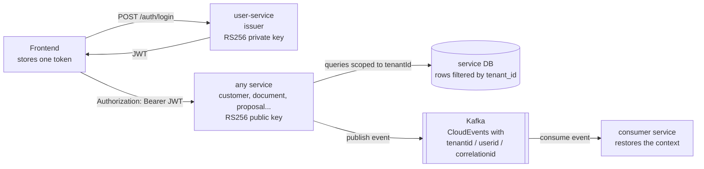
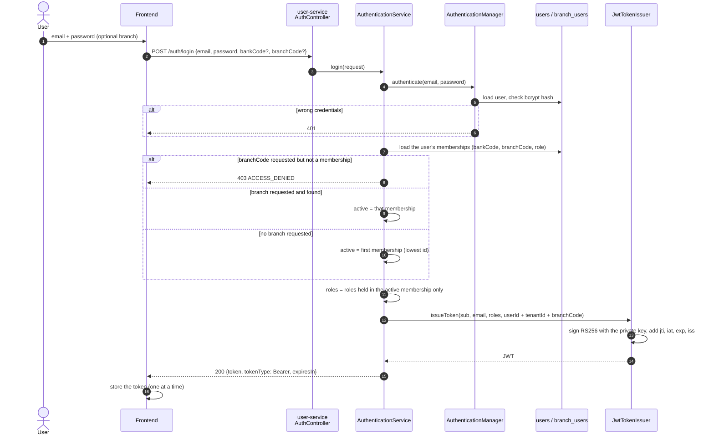
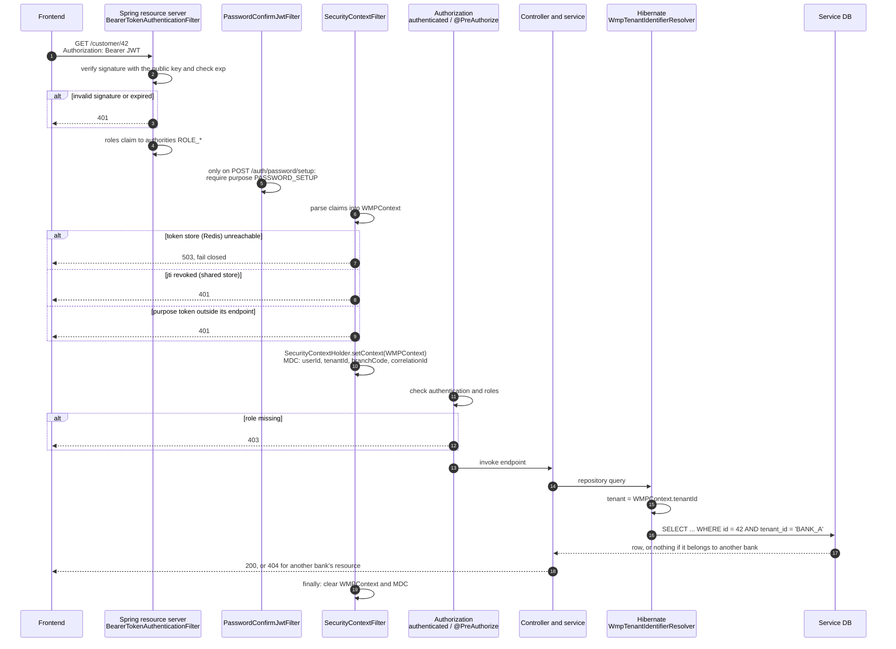
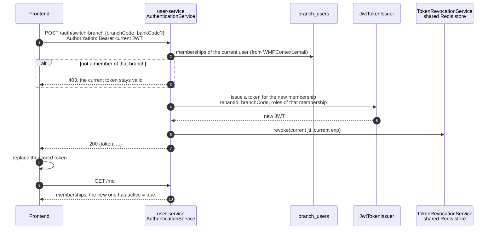
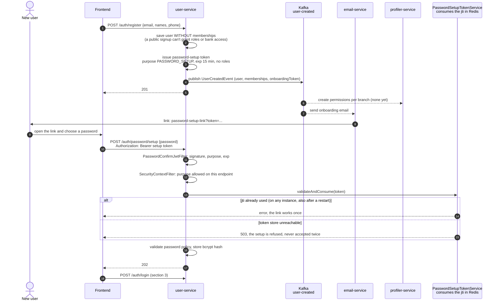
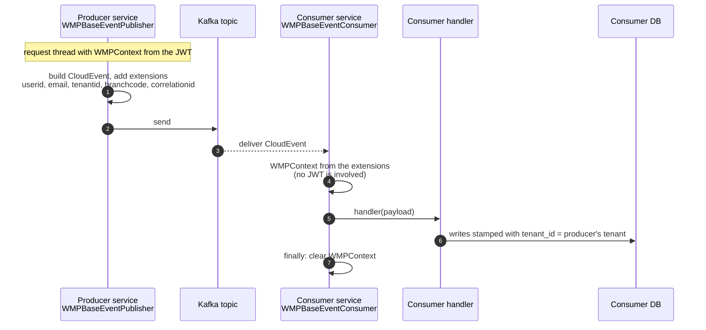
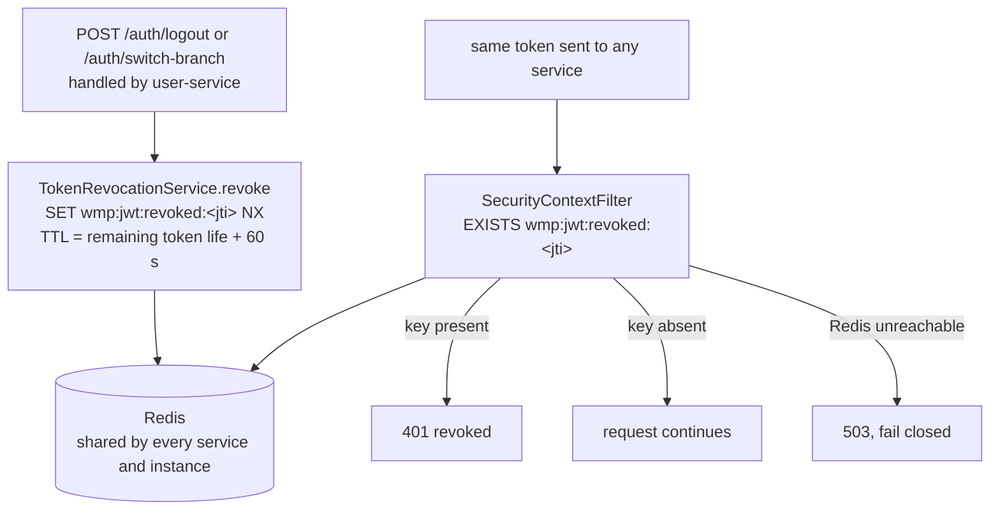

# JWT authentication and tenancy

How the Wealth Management Platform issues, validates and propagates JSON Web Tokens (JWT), and how a token decides
which bank's (tenant's) data a request can see.

## Contents
1. [Overview](#1-overview)
2. [Token anatomy](#2-token-anatomy)
3. [Login: issuing a session token](#3-login-issuing-a-session-token)
4. [Validating a request in any service](#4-validating-a-request-in-any-service)
5. [Switching branch](#5-switching-branch)
6. [Registration and password setup](#6-registration-and-password-setup)
7. [Propagating the context to Kafka events](#7-propagating-the-context-to-kafka-events)
8. [Logout and revocation](#8-logout-and-revocation)
9. [Local development](#9-local-development)
10. [Known limitations and follow-ups](#10-known-limitations-and-follow-ups)

---

## 1. Overview

- **user-service is the only issuer.** It signs tokens with an RSA private key (RS256).
- **Every service verifies** tokens with the matching public key. No service calls user-service to validate a token.
- **One token = one active membership.** A user can belong to several branches of several banks; the token is issued for
  one of them and carries its bank (`tenantId`), branch (`branchCode`) and the roles held there.
- **The tenant scopes the data.** Hibernate reads `tenantId` from the request context and filters every query on
  bank-owned entities. A bank never sees another bank's rows.
- **Events carry the context.** Kafka events forward user, tenant and correlation id, so consumers act on behalf of the
  original caller and in the same tenant.



---

## 2. Token anatomy

A JWT has three dot-separated parts: header, payload (claims) and signature. Only the signature makes it trustworthy:
anyone can read the claims, so **tokens never contain secrets**.

### Claims

| Claim | Example | Set by | Read by | Meaning |
|---|---|---|---|---|
| `sub` | `5f0c7b2e-...` | user-service | — | User id (subject) |
| `jti` | `b1e4...` | user-service | revocation, password setup | Unique token id |
| `iss` | `user-service` | user-service | — | Issuer |
| `iat` / `exp` | epoch seconds | user-service | Spring resource server | Issued at / expires at |
| `userId` | `5f0c7b2e-...` | user-service | `WMPContext` | User id |
| `email` | `ada@bank.test` | user-service | `WMPContext`, JPA auditing (`created_by`) | User email |
| `roles` | `["ADVISOR"]` | user-service | Spring Security (`ROLE_ADVISOR`), `@PreAuthorize` | Roles of the **active membership only** |
| `tenantId` | `BANK_A` | user-service | `WMPContext`, Hibernate tenant filter, MDC, events | Bank of the active membership |
| `branchCode` | `BR_01` | user-service | `WMPContext`, profiler permissions, MDC, events | Branch of the active membership |
| `purpose` | `PASSWORD_SETUP` | user-service | `SecurityContextFilter`, `PasswordConfirmJwtFilter` | Present only on single-purpose tokens |

Custom claim names live in `WmpJwtClaims` (platform-core) and are shared by the issuer and every parser.

### Token types

| | Session token | Password-setup token |
|---|---|---|
| Issued by | `POST /auth/login`, `POST /auth/switch-branch` | `POST /auth/register` (sent by email) |
| Lifetime | `security.jwt.expiration-seconds` (default 3600 s) | `security.jwt.password-setup-expiration-seconds` (default 900 s) |
| `roles` / `tenantId` | yes / yes (if the user has a membership) | no / no |
| `purpose` | — | `PASSWORD_SETUP` |
| Accepted on | every authenticated endpoint | **only** `POST /auth/password/setup`, once |

---

## 3. Login: issuing a session token



**A user without any membership** gets a `CUSTOMER` token with no `tenantId`. It works on user endpoints like `/me`, but
every bank-owned endpoint refuses to write (401 `MISSING_HEADER_TOKEN_FIELD [tenantId]`) and reads find nothing.

---

## 4. Validating a request in any service

Every service gets the same security setup from platform-core (`SecurityConfig`, `JwtConfiguration`). The filters
run in this order:



Points worth knowing:
- **Another bank's resource answers 404, not 403.** For the caller it simply doesn't exist.
- **Writes are stamped automatically.** Saving a `TenantScopedEntity` fills `tenant_id` from the token; a request
  without a tenant can't save one.
- **Native SQL is not filtered** by Hibernate: add `tenant_id = :tenantId` yourself, or use JPQL.
- The context lives in a `ThreadLocal`, so `@Async` work and new threads don't inherit it automatically.

---

## 5. Switching branch



`GET /me` lists every membership and flags the one the token was issued for (`active: true`). The FE uses that
membership's role for its UI and offers the others in a branch switcher.

---

## 6. Registration and password setup



The setup token is **refused on every other endpoint** of every service (401). It can't be used as a session token.

---

## 7. Propagating the context to Kafka events



Events don't carry the JWT itself. The consumer trusts the extensions because only platform services can publish to
the topics.

---

## 8. Logout and revocation



- **Revocation is platform-wide.** A token revoked by user-service is rejected by every service and instance, because
  they all check the same Redis store.
- **Entries clean themselves up.** Each key expires shortly after the token itself would, so nothing needs a cleanup
  job.
- **Fail closed.** If Redis can't be reached, authenticated requests get 503 instead of risking a revoked token being
  accepted. Requests without a token are not affected.
- The store also holds consumed single-use tokens (`wmp:jwt:setup-used:<jti>`), so a password-setup link works once.

| Namespace | Key | Written by | Read by |
|---|---|---|---|
| `revoked` | `wmp:jwt:revoked:<jti>` | user-service on logout and branch switch | `SecurityContextFilter` in every service |
| `setup-used` | `wmp:jwt:setup-used:<jti>` | `PasswordSetupTokenService` on first use (atomic `SET NX`) | the same call: a second write fails |

Clients should still discard the token on logout and branch switch.

---

## 9. Local development

### Keys and the local token
- `core/platform-core/src/main/resources/jwt/public_key.pem`: public key every service uses by default
  (`security.jwt.publicKeyPath` in `platform-shared-properties.yaml`).
- `business-modules/user-service/user-core/src/main/resources/keys/`: key pair user-service signs with.
- `core/platform-core/src/main/resources/jwt/local_token.txt`: a ready-made token without expiry:
  `tenantId=LOCAL-BANK`, `branchCode=LOCAL-BRANCH-01`, `roles=[ADMIN, SUPERVISOR]`, `email=john@doe.com`.

**These keys are for local development only.** Never use them in a shared environment.

### Signing a test token
Use a different tenant to test isolation. On Windows, run this in Git Bash, which ships with `openssl`.

```bash
cd core/platform-core/src/main/resources/jwt
b64() { openssl base64 -A | tr '+/' '-_' | tr -d '='; }
HEADER=$(printf '%s' '{"alg":"RS256","typ":"JWT"}' | b64)
PAYLOAD=$(printf '%s' '{"sub":"jane","userId":"jane","email":"jane@roe.test","tenantId":"OTHER-BANK","branchCode":"OTHER-BRANCH-01","roles":["ADVISOR"]}' | b64)
SIGNATURE=$(printf '%s' "$HEADER.$PAYLOAD" | openssl dgst -sha256 -sign private_key.pem -binary | b64)
echo "$HEADER.$PAYLOAD.$SIGNATURE"
```

Then call a service with it: `curl -H "Authorization: Bearer <token>" http://localhost:8090/customer-service/customer/<id>`.

### Configuration keys
| Key | Where | Default | Purpose |
|---|---|---|---|
| `security.jwt.publicKeyPath` | every service (`platform-shared-properties.yaml`) | `classpath:jwt/public_key.pem` | Verification key |
| `security.jwt.header` / `prefix` | every service | `Authorization` / `Bearer` | Where the token is read |
| `security.jwt.private-key-path` | user-service | `classpath:keys/private_key.pem` | Signing key |
| `security.jwt.issuer` | user-service | `user-service` | `iss` claim |
| `security.jwt.expiration-seconds` | user-service | `3600` | Session token lifetime |
| `security.jwt.password-setup-expiration-seconds` | user-service | `900` | Setup token lifetime |
| `wmp.onboarding.password-setup-link` | email-service | `http://localhost:4200/onboarding/setup-password` | Link in the onboarding email |
| `platform.security.token-store.type` | every service | `REDIS` | `REDIS` (shared) or `IN_MEMORY` (per instance, for tests or isolated runs) |
| `platform.security.token-store.key-prefix` / `clock-skew` | every service | `wmp:jwt` / `60s` | Redis key prefix; extra TTL on top of the token's remaining life |
| `spring.data.redis.host` / `port` / `timeout` | every service | `localhost` / `6379` / `2s` (env `REDIS_HOST`, `REDIS_PORT`) | Token store connection; a short timeout so a dead Redis fails fast |

---

## 10. Known limitations and follow-ups

| Limitation | Impact | Proposed fix |
|---|---|---|
| Only single tokens can be revoked | No "log out everywhere"; a password change or a disabled user doesn't invalidate tokens already issued | Per-user "tokens issued before T are invalid" timestamp in the same store, checked by `SecurityContextFilter`; build it with disable/enable user |
| Redis is a hard dependency of authenticated traffic | A Redis outage answers 503 on every authenticated call (fail closed, by design) | Run Redis highly available (replica + sentinel, or a managed service) outside local |
| One static key pair, no `kid` header | Rotating the key invalidates every token at once | Publish keys with ids (JWKS) and add `kid` to the header |
| Keys and `jwt_configuration.md` (which contains a private key) are in the repo | Fine for local development only | Load keys from a secret manager outside local profiles |
| No root tenant | Group-level users can't see several banks at once | Comes with visibility scopes (Hibernate `isRoot`) |
| The context is a `ThreadLocal` | `@Async` tasks and scheduled jobs have no tenant | Context-propagating executor and a "run as tenant" helper |
