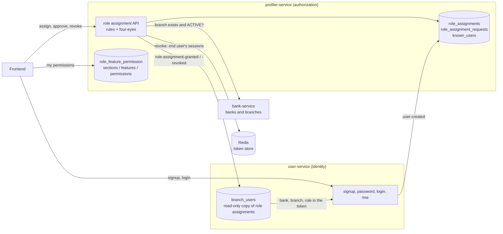
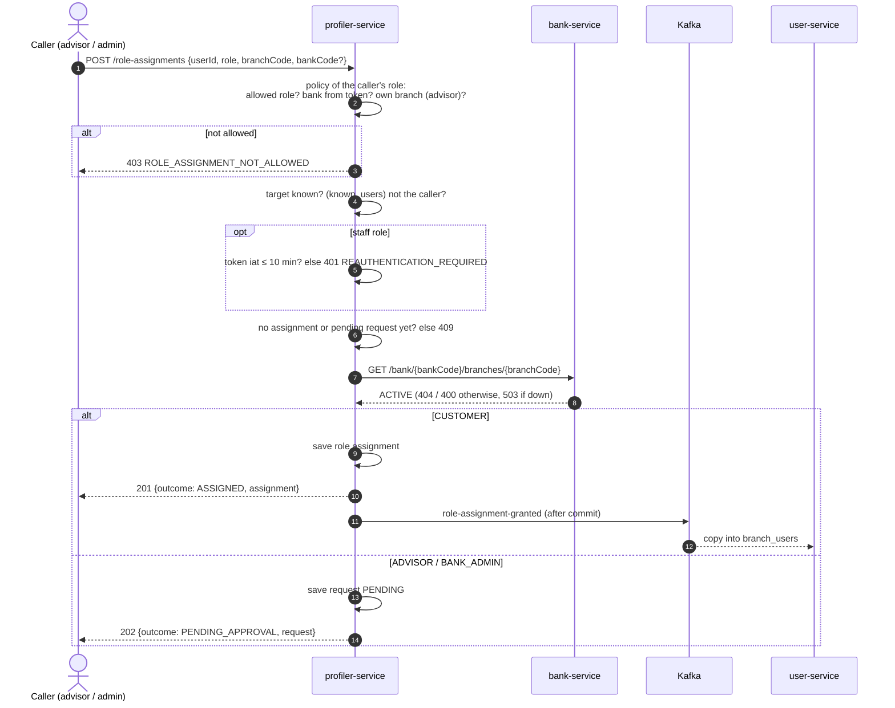
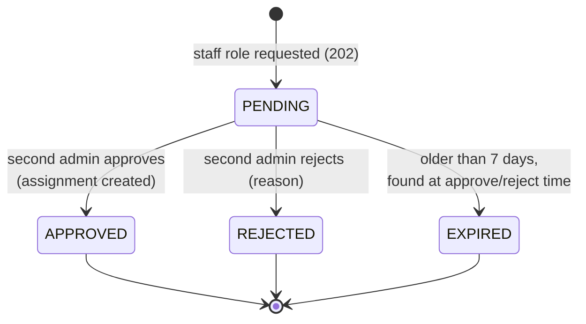
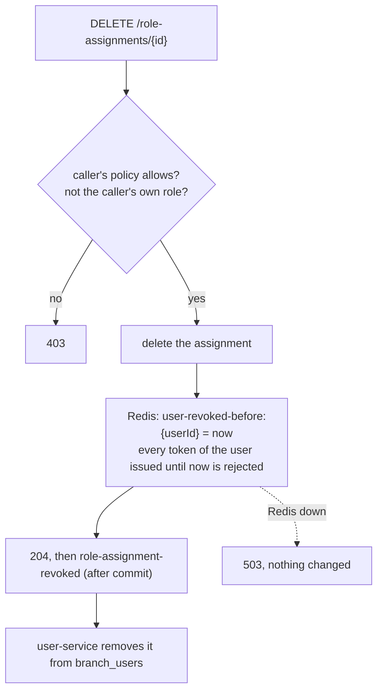
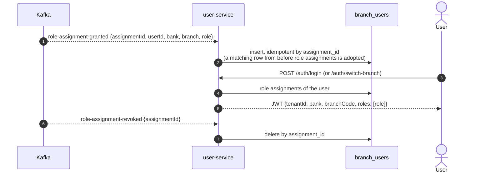
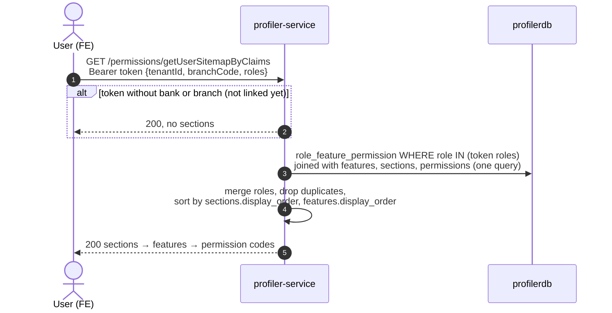
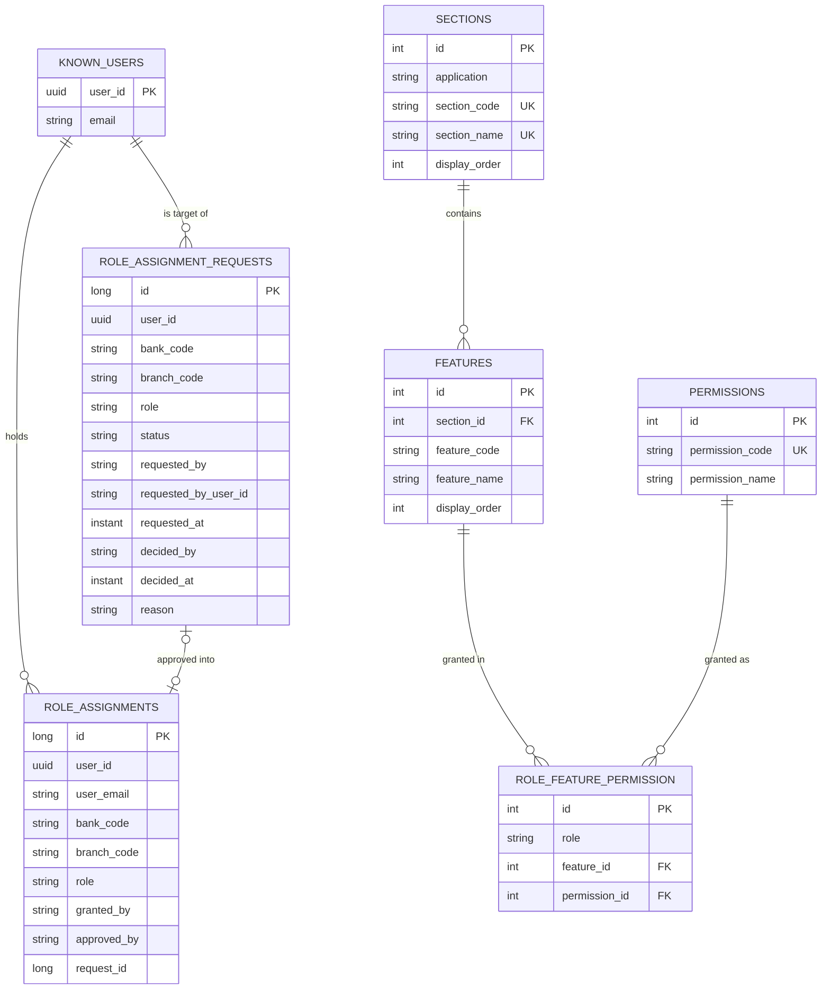

# Roles, role assignments and permissions

Reference for **who may do what** on the platform: the roles, how a user gets one (role assignments), the rules for
granting and revoking them, and how they turn into functional permissions. For a hands-on walkthrough from an empty
installation see [first platform run](../platform/first-platform-run.md); for how tokens carry the role see
[JWT authentication](jwt-authentication.md).

## Contents
1. [Vocabulary](#1-vocabulary)
2. [Which service owns what](#2-which-service-owns-what)
3. [Roles](#3-roles)
4. [Who may assign what](#4-who-may-assign-what)
5. [Assigning a role](#5-assigning-a-role)
6. [Four-eyes requests](#6-four-eyes-requests)
7. [Revoking a role](#7-revoking-a-role)
8. [From role assignment to token](#8-from-role-assignment-to-token)
9. [From role assignment to permissions](#9-from-role-assignment-to-permissions)
10. [API reference](#10-api-reference)
11. [Events](#11-events)
12. [Data model](#12-data-model)
13. [Design notes and known limitations](#13-design-notes-and-known-limitations)

---

## 1. Vocabulary

| Term | Meaning | Example |
|---|---|---|
| **Role** | A platform-wide profile (`WmpRole` in platform-core) | `ADVISOR` |
| **Role assignment** | A user holds a role in one branch of one bank | Ada is `ADVISOR` at `BANK_A` / `BR_01` |
| **Active role assignment** | The one a token was issued for: its bank is the token's `tenantId`, its branch the `branchCode`, its role the `roles` claim | |
| **Role assignment request** | A staff assignment waiting for a second admin (four-eyes) | "make Ada ADVISOR at BR_01", PENDING |
| **Permission** | What a role may do: a feature plus a permission code (`role_feature_permission`) | `ORDERS / place_order` + `USE` |
| **Tenant** | A bank, identified by its bank code. Business data is scoped by it | `BANK_A` |

A user doesn't receive permissions directly: it receives **role assignments**, and the permissions follow from the
role.

## 2. Which service owns what

- **profiler-service is the source of truth** for role assignments and permissions. All rules live there.
- **user-service keeps a copy** (`branch_users`), fed only by profiler's events, so login never calls profiler and keeps
  working when profiler is down. Nothing else writes to it.
- **bank-service** says whether a branch exists and is ACTIVE.
- **Redis** (shared token store, platform-core) lets profiler end a user's sessions in every service at once.

## 3. Roles

From least to most privileged (`raff.stein.platformcore.security.role.WmpRole`):

| Role | Scope | Typical user | Granted by |
|---|---|---|---|
| `CUSTOMER` | own data in one bank branch | a bank's client | an ADVISOR of that branch, or a BANK_ADMIN of the bank |
| `ADVISOR` | the branch's customers | private banker, advisor | a BANK_ADMIN, approved by a second BANK_ADMIN |
| `BANK_ADMIN` | one bank | the bank's administrator | a PLATFORM_ADMIN, approved by a second PLATFORM_ADMIN |
| `PLATFORM_ADMIN` | the platform (bank code `PLATFORM`) | the platform operator | **nobody**: created only by the bootstrap |

- A PLATFORM_ADMIN assignment uses the pseudo bank and branch `PLATFORM`. No business data belongs to that tenant, so
  a platform admin sees **no bank data**: its job is to create bank admins.
- Role names are parsed exactly. An unknown role stored anywhere grants nothing (there is no fallback to CUSTOMER).
- A user with no role assignment can log in but gets a `CUSTOMER` token **without tenant**: it can't read or write any
  bank data (see [JWT authentication](jwt-authentication.md), section 3).

## 4. Who may assign what

The caller's **active** role (the one in its token) decides. When a token carries several roles, the most privileged
one is used.

| Caller | May assign | Where | Effect | Recent login (≤ 10 min) |
|---|---|---|---|---|
| ADVISOR | CUSTOMER | only the bank **and branch** of its token | immediate | no |
| BANK_ADMIN | CUSTOMER | its bank, any ACTIVE branch | immediate | no |
| BANK_ADMIN | ADVISOR | its bank, any ACTIVE branch | **PENDING**, needs a second BANK_ADMIN of that bank | yes |
| PLATFORM_ADMIN | BANK_ADMIN | any bank (`bankCode` in the request) | **PENDING**, needs a second PLATFORM_ADMIN | yes |
| CUSTOMER | nothing | — | 403 | — |
| anyone | PLATFORM_ADMIN | — | 403 (bootstrap only) | — |

Rules that apply to everyone:
- **The bank comes from the caller's token.** Only a PLATFORM_ADMIN may name a bank; anyone else sending `bankCode`
  gets 403.
- **Nobody assigns, approves or revokes for themselves.** Requester and approver must be different people (compared by
  user id).
- **The branch must exist in that bank and be ACTIVE** (bank-service, looked up by bank code + branch code).
- **No duplicates**: the same user, bank, branch and role can't be assigned twice, nor requested while a request is
  pending (409).
- **Recent login** for sensitive actions: the token's `iat` must be at most 10 minutes old, otherwise
  `401 REAUTHENTICATION_REQUIRED`. The FE asks the admin to sign in again and retries. This is not a session end.

## 5. Assigning a role

The user gets the new role **at its next login or branch switch**: an existing token is never changed.

## 6. Four-eyes requests

| Request for | May decide | Must not be |
|---|---|---|
| ADVISOR in bank X | a BANK_ADMIN of bank X | the requester, the target |
| BANK_ADMIN of bank X | a PLATFORM_ADMIN | the requester, the target |

- Approving re-checks that the branch is still ACTIVE and that the assignment doesn't exist yet.
- The assignment records both people: `grantedBy` = the requester, `approvedBy` = the approver. The request keeps
  `requestedBy`, `decidedBy`, `decidedAt` and the rejection `reason`: it is the audit trail.
- Expiry is lazy (there is no scheduler yet): a stale request turns EXPIRED when someone tries to decide it, and that
  call answers `409 ROLE_ASSIGNMENT_REQUEST_NOT_PENDING`.
- A bank needs **two BANK_ADMINs** before it can get advisors, and the platform needs **two PLATFORM_ADMINs** before it
  can get bank admins.

## 7. Revoking a role

| Caller | May revoke | Recent login |
|---|---|---|
| ADVISOR | CUSTOMER of its own branch | no |
| BANK_ADMIN | CUSTOMER or ADVISOR in its bank | yes |
| PLATFORM_ADMIN | BANK_ADMIN | yes |

- **Every session of the user ends**, in every service, immediately: all its tokens issued up to the revocation are
  rejected with 401, including tokens for other branches. The user logs in again and gets a token for what it still
  holds.
- The revocation entry lives for the longest token lifetime (1 hour), after which every older token has expired anyway.

## 8. From role assignment to token

- `GET /me` lists the copies (`userBranchRoles`), each with the profiler `id` (to revoke it) and `active: true` on the
  one of the current token.
- Replayed or duplicated events change nothing. A grant for a user user-service doesn't know is skipped with a warning.

## 9. From role assignment to permissions

A **permission** is what a role may do: one permission code on one feature. Everything is in profiler's database, and
a user's permissions are **computed on each request**. Nothing is copied per user, so there's nothing to keep in sync.

- **The role comes from the token**, the active role assignment. That keeps the answer consistent with what the
  services enforce (`@PreAuthorize` reads the same roles). A newly assigned role shows up after the next login or
  branch switch, like the token itself.
- **A change applies at once.** Granting or removing a permission is one row in `role_feature_permission`, with
  effect on the next request of every user holding that role. No restart, no rebuild.
- BANK_ADMIN and PLATFORM_ADMIN have no rows yet. Their rights come from the role in the token (`@PreAuthorize`),
  not from feature permissions. The FE has no admin section yet.

### The catalogue

The catalogue mirrors the FE navigation (`Wealth-Management-Platform-FE/src/app/layout/navigation.ts`): a **section**
is a top-bar section, a **feature** is a side-nav item. Application `WMP`. `display_order` gives the navigation order.

| # | Section | FE key | Features, in order (FE path under `/app`) |
|---|---|---|---|
| 1 | `ACCOUNT` (Account) | `account` | `HOME` (home), `INVESTOR_PROFILE` (investor-profile, investor-profile/update), `TRANSACTIONS`, `ASSETS`, `BANK_TRANSFERS`, `TAX_CREDITS`, `SECURITIES_TRANSFER` |
| 2 | `INVESTMENTS` (Investments) | `investments` | `OVERVIEW`, `POSITIONS`, `ORDERS`, `PERFORMANCE`, `ALLOCATION` |
| 3 | `NEWS_MARKETS` (Markets) | `news-markets` | `OVERVIEW`, `MARKET_NEWS`, `INDICES`, `CURRENCIES`, `COMMODITIES` |
| 4 | `WORKSPACE` (Workspace) | `workspace` | `OVERVIEW` (advisor), `CLIENTS`, `MIFID_REVIEWS`, `PROPOSALS`, `ORDERS` |

Permission codes: `VIEW` (see it), `USE` (act: place, transfer, select), `EDIT` (change data), `DOWNLOAD`.

### Who gets what (`role_feature_permission`)

| Feature | CUSTOMER | ADVISOR |
|---|---|---|
| Account: every feature | `VIEW` | `VIEW` |
| `ACCOUNT/INVESTOR_PROFILE` | `VIEW`, `EDIT` | `VIEW`, `EDIT` |
| `ACCOUNT/BANK_TRANSFERS`, `ACCOUNT/SECURITIES_TRANSFER` | `VIEW`, `USE` | `VIEW`, `USE` |
| Investments: every feature | `VIEW` | `VIEW` |
| `INVESTMENTS/ORDERS` | `VIEW`, `USE` | `VIEW`, `USE` |
| Markets: every feature | `VIEW` | `VIEW` |
| `WORKSPACE/OVERVIEW` | – | `VIEW` |
| `WORKSPACE/CLIENTS`, `WORKSPACE/ORDERS` | – | `VIEW`, `USE` |
| `WORKSPACE/MIFID_REVIEWS`, `WORKSPACE/PROPOSALS` | – | `VIEW`, `EDIT` |

That's 21 rows for CUSTOMER and 30 for ADVISOR. An advisor also gets the customer sections because the FE lets it act
on behalf of a client.

### Changing permissions

All changes are SQL against profilerdb, effective immediately:

| To... | Do |
|---|---|
| grant or remove a permission | insert into / delete from `role_feature_permission` (role, feature, permission) |
| add a feature or section | add it to `features` / `sections` with its `display_order`, then grant it |
| reorder the navigation | update `display_order` |

Keep `business-modules/profiler-service/profiler-core/src/main/resources/sql/populate_config_tables.sql` in step: it
is the source a fresh database is built from.
- **It's idempotent.** Re-running it adds what's missing and updates names and order.
- **It refuses a grant that names an unknown section, feature or permission code** (the script fails and lists the
  bad rows). The foreign keys then guarantee that every stored grant points at real catalogue entries.
- **Existing databases** get structural changes through a script in `sql/migrations/`, run by hand until the platform
  adopts Flyway or Liquibase (see the script header for the order).

## 10. API reference

Base URL `http://localhost:8082/profiler-service`; every call needs `Authorization: Bearer <token>`. Errors use the
platform `ErrorResponse` (`errorCode`, `category`, `errorMessage`, `traceId`).

| Method and path | Roles | Body / query | Success |
|---|---|---|---|
| `POST /role-assignments` | ADVISOR, BANK_ADMIN, PLATFORM_ADMIN | `{userId, role, branchCode, bankCode?}` | 201 `ASSIGNED` / 202 `PENDING_APPROVAL` (`AssignRoleResultDTO`) |
| `GET /role-assignments?userId=` | same | | 200, the user's assignments the caller may see |
| `DELETE /role-assignments/{id}` | same | | 204 |
| `GET /role-assignment-requests?status=` | BANK_ADMIN, PLATFORM_ADMIN | `PENDING` / `APPROVED` / `REJECTED` / `EXPIRED` | 200, newest first |
| `POST /role-assignment-requests/{id}/approve` | BANK_ADMIN, PLATFORM_ADMIN | | 200 `RoleAssignmentDTO` |
| `POST /role-assignment-requests/{id}/reject` | BANK_ADMIN, PLATFORM_ADMIN | `{reason}` | 200 `RoleAssignmentRequestDTO` |

| Status | `errorCode` | When | What the client does |
|---|---|---|---|
| 400 | `REQUEST_VALIDATION_ERROR` | invalid input, missing `bankCode` for a PLATFORM_ADMIN, branch not ACTIVE | fix the input |
| 401 | `REAUTHENTICATION_REQUIRED` | sensitive action with a login older than 10 minutes | sign in again, retry |
| 401 | (no body) | missing, invalid, expired or revoked token | session ended |
| 403 | `ROLE_ASSIGNMENT_NOT_ALLOWED` | the caller's role may not do this, here, or to this user | show "not allowed" |
| 404 | `OBJECT_NOT_FOUND` | unknown user, branch, assignment or request | |
| 409 | `ROLE_ASSIGNMENT_ALREADY_EXISTS` | already assigned or already pending | |
| 409 | `ROLE_ASSIGNMENT_REQUEST_NOT_PENDING` | request already decided or EXPIRED | refresh the list |
| 503 | `DEPENDENCY_UNAVAILABLE` / `TOKEN_STORE_UNAVAILABLE` | bank-service or Redis down; nothing changed | retry later |

Full contract: `business-modules/profiler-service/profiler-api-data/profiler-api-data.yaml`.

## 11. Events

| Topic | Producer | Consumers | Payload |
|---|---|---|---|
| `<env>.<tenant>.profiler-service.role-assignment-granted` | profiler | user-service | `assignmentId, userId, email, bankCode, branchCode, role, grantedBy, approvedBy` |
| `<env>.<tenant>.profiler-service.role-assignment-revoked` | profiler | user-service | `assignmentId, userId, email, bankCode, branchCode, role, revokedBy` |
| `<env>.<tenant>.user-service.user-created` | user-service | profiler (`known_users`, bootstrap), email-service | user, onboarding token |

Profiler publishes **after the transaction commits** (`@TransactionalEventListener(AFTER_COMMIT)`): a rolled-back
assignment is never announced. Schemas: `profiler-event-data.yaml`, `user-event-data.yaml`.

## 12. Data model

- `features` is unique on (`section_id`, `feature_code`), `role_feature_permission` on (`role`, `feature_id`,
  `permission_id`).
- `role` (in `role_assignments` and `role_feature_permission`) is a `WmpRole` name, not a foreign key: roles are an
  enum in code.
- The role assignments and the role permissions meet only through the role value: a user's permissions are the rows
  of the role it holds.
- user-service's `branch_users` mirrors `role_assignments` (`assignment_id` = `role_assignments.id`).

## 13. Design notes and known limitations

- **Not tenant-scoped on purpose.** These tables span banks (a PLATFORM_ADMIN works across them, and login reads every
  bank of a user), so they extend `BaseDateEntity`, not `TenantScopedEntity`. Every check filters on the bank
  explicitly, in the policies.
- **Eventual consistency.** A new role reaches the token after the event is applied, usually well under a second, and
  only at the next login or branch switch. Revocation does not wait for events: sessions end immediately via Redis.
- **No outbox yet.** A crash between commit and publish loses the event: user-service would miss a grant or a
  revocation. Phase 0 adds a transactional outbox. Until then, re-assigning repairs a missed grant, and a missed
  revocation is still enforced for sessions by Redis.
- **Lazy expiry.** Pending requests expire only when someone tries to decide them (no scheduler yet).
- **Admin permissions.** Only CUSTOMER and ADVISOR have feature permissions; admin roles get a section when the FE gets
  admin screens.
- **Visibility scopes** (own customers, branch, bank) from the legacy requirements are not built yet. They will live in
  profiler too.
